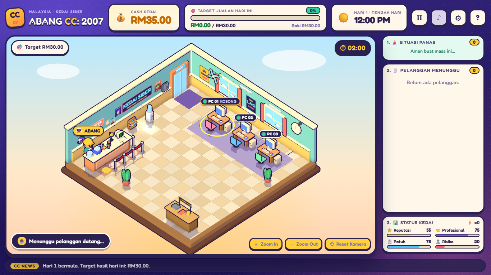
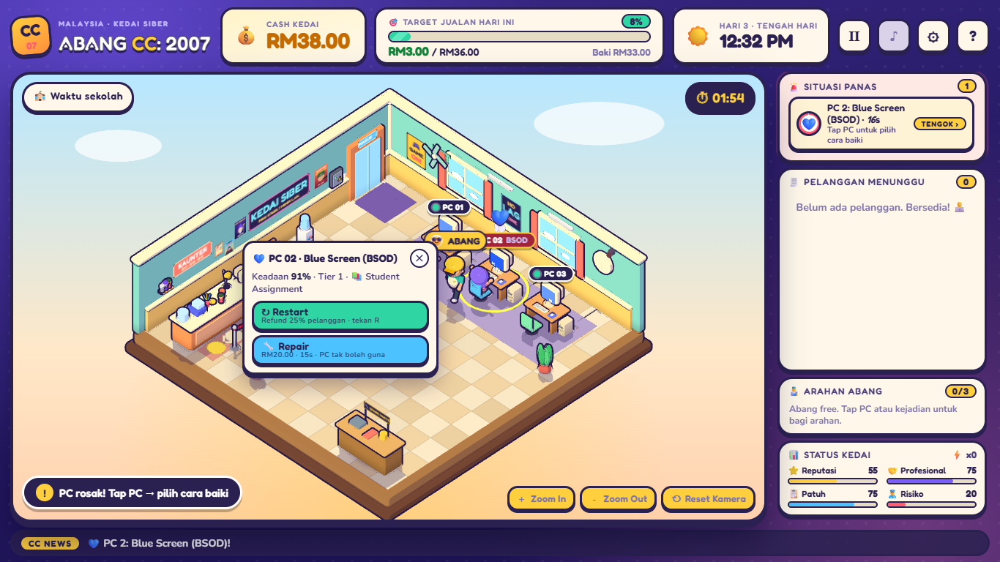
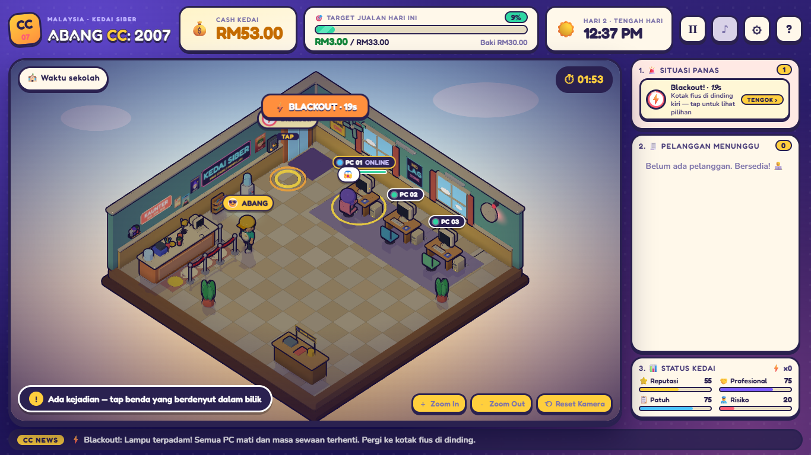
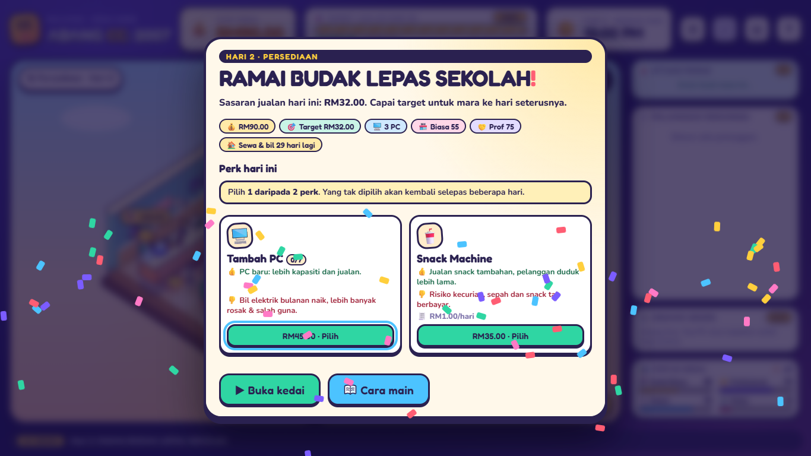

<div align="center">

# 🖥️ ABANG CC: 2007

### Run a cozy cyber café in Malaysia, 2007.

Seat the customers · fix the crashing PCs · catch the cheaters · survive the blackout · hit the daily target.

**Alpha 0.12** &nbsp;·&nbsp; 3D cartoon &nbsp;·&nbsp; Plays in your browser &nbsp;·&nbsp; No install &nbsp;·&nbsp; Works on desktop and phone



</div>

---

## ▶️ Play in 10 seconds

1. Open **`dist/ABANG_CC_2007_ALPHA_12.html`** in Chrome, Edge or Firefox. It's a single file, so just double-click it.
2. Wait for the loading screen (about 3 seconds). You land on the **main menu**: press **Mula Main** (Play) for a new game. Once you have a game going, the menu also shows **Sambung Main** (Continue, picks up where you stopped) and **Main Semula** (Restart, asks first). **Cara Main** is the quick guide and **Koleksi** is your hats.
3. Follow the **How to play** steps below. Day 1 is a gentle tutorial and has no random trouble.

> 💡 Prefer a web server? Run `npx serve .` or `python -m http.server` in this folder and open `index.html`.

---

## 🎯 Your goal

You are **Abang**, the owner of a tiny *kedai siber*. Each day (a "shift") you must earn enough money to reach the **daily target**.

| | |
|---|---|
| ✅ **Reach the target** | The day ends with a report. From day 2 you pick **one perk** to upgrade your shop, then the next day starts. |
| ❌ **Miss the target** | You replay that same day. Everything from earlier days is kept. |
| 💰 **Target** | RM30 on day 1, then +RM3 a day up to day 10 (RM57), then +RM4 a day, later +RM5. Upgrades are how you keep up. |
| 🧾 **Rent and bills** | Paid once a month (every 30 days), not every day. |

---

## 🕹️ How to play

### 1. Seat your customers

<table>
<tr>
<td width="60"><h2>①</h2></td>
<td><b>Tap a customer</b>, either in the room or in the queue list. A small menu pops up right beside them.</td>
</tr>
<tr>
<td><h2>②</h2></td>
<td>Choose <b>30 / 60 / 90 minutes</b> from that menu (keys <code>1</code> <code>2</code> <code>3</code>). The <b>★</b> marks what they asked for. Any other length earns less, so match the ★ whenever you can.</td>
</tr>
<tr>
<td><h2>③</h2></td>
<td>Tap a <b>PC that glows green</b>. Abang walks them over and the session starts.</td>
</tr>
</table>

> ⚡ **Shortcut:** **double-tap a customer** (or press the **⚡ Auto-duduk** button in their menu, or `A`) to seat them in one step. They get the length they asked for (★) on the nearest free PC. It's exactly as good as picking the right length yourself.

> ⏱️ Sessions are short: 30 min = 10 seconds, 60 min = 16 seconds, 90 min = 22 seconds. **Customers lose patience while they wait**, so keep the queue moving.

### 2. Fix broken PCs

Tap a PC showing a problem. A small menu pops up right beside it. Pick an action and Abang walks over and does it.

| Icon | Problem | What it means |
|:-:|---|---|
| 💥 | **Software crash** | Restart or repair it |
| 🥶 | **Frozen screen** | Restart or repair it |
| 🔥 | **Overheating** | Cool it down *quickly* or it burns out |
| 💙 | **Blue screen (BSOD)** | Restart or repair it. The customer will leave if you wait too long |
| 📡 | **Internet lost** | Reset the connection |
| 🔧 | **Hardware broken** | Needs a proper repair |

💸 Restarting a PC while someone is using it refunds them **25%**, once per incident.



**Abang's job list.** Everything you tap for Abang to do lines up in the **Arahan Abang** panel on the right (up to 3 jobs). Use **↑** to send a job earlier or **✕** to cancel it, which is free, since nothing is charged until a job is done. You can't cancel the job he's already working on.

### 3. Handle trouble

| Icon | Situation | What to do |
|:-:|---|---|
| ❓ 👀 | **Suspicious customer** | **Tegur baik-baik** (talk to them gently) is safe. **Tuduh & halau** (accuse and kick out) pays more if they're guilty, but costs you if they're innocent. You never see who's guilty for sure. CCTV gives an imperfect hint. |
| 🔊 | **Loud video** | Ask them to turn it down |
| 💢 | **Two customers fighting** | Break it up fast |
| 🖱️ | **Missing mouse** | Sort it out before they get upset |

### 4. Special events

Events show up as **real things in the room**, not pop-up cards. Tap the person or object, or tap **TENGOK** ("look") on a card under *Situasi Panas* ("hot situations"). The choices then appear on the thing itself.

| Event | What happens |
|---|---|
| 🎒 **School group** | Offer a group deal or charge the normal price |
| 🎞️ **Big downloader** | Extra cash now, but the line lags for 18 seconds |
| 👩 **Mak looking for her kid** | Help her search or ask her to wait |
| 🏫 **Truant students** (school hours) | Turn them away, or take a tip and risk an inspection |
| 🏆 **LAN tournament** | Host it for a fee: every PC fills up and things get rowdy |
| ⚡ **Blackout** | Every PC dies and the clock stops. Walk to the **fuse box** (RM8) or wait it out |
| 🥤 **Missing snacks** (needs a snack machine) | Check the stock, or accuse someone and risk being wrong |
| 🧃 **Spilled drink** | Call a cleaner (RM6) or mop it yourself |
| 👮 **The inspector** | Show your records and stay professional, or pretend to be busy and he gets suspicious |



### 5. Pick a perk (from day 2)

After each successful day you're offered **two random perks**. Each one helps, and each one has a **downside**. Choose with care.

| Perk | Benefit | Downside |
|---|---|---|
| 🖥️ **Add a PC** | More seats, more sales | Higher electricity bill, more breakdowns |
| 🥤 **Snack machine** | Extra sales, customers stay longer | Theft and mess |
| 🛠️ **Spare parts rack** | Repairs 30% cheaper and 25% faster | Daily upkeep |
| 🛡️ **Content filter** | Fewer shady-website cases | Daily fee, and customers complain about blocked sites |
| 📡 **New router** | More bandwidth, less lag | Daily subscription |
| ❄️ **Air-conditioning** | More patient customers, cooler PCs | Daily electricity |
| 🏃 **Abang Laju** | Abang moves and works faster | Daily energy-drink bill |
| 🖨️ **Printer corner** | Attracts students, adds printing income | Paper jams and paper costs |
| 📷 **CCTV** | Hints at who's suspicious | Daily upkeep, and the hint isn't always right |
| 📣 **Promo poster** (cheap) | More customers | Attracts more RM1 kids who get bored fast |



---

## 👥 Meet the customers

| | Customer | What they're like |
|:-:|---|---|
| 👓 | **Pakcik Internet** | Patient. Needs help logging in. |
| 🎮 | **Kaki FPS** | Wants a fast, lag-free PC. |
| 🔥 | **Kaki Panas Baran** | Short temper, starts fights. Don't give him a broken PC. |
| 📚 | **Student Assignment** | Just wants to finish the homework. |
| 🐉 | **Kaki MMORPG** *(from day 4)* | Books 90 minutes and stays. |
| 🪙 | **Budak RM1** | Cheap and impatient. Books 30 minutes. |
| 🎯 | **Kaki LAN** | Plays in groups. Loud. |
| 🌙 | **Lepak Sampai Pagi** *(from day 3, late at night)* | Stays on after the session ends. |
| 💬 | **Kaki MIRC** *(from day 2)* | Chats on IRC. Sometimes browses suspicious sites. |

---

## 🎩 Keep your progress: the Koleksi

Clear certain days and Abang unlocks new hats: 🎧 **Headphone Gamer** (clear day 3), 👒 **Topi Jerami** (day 6) and 👑 **Mahkota Raja CC** (day 10). Wear them from **Koleksi** on the main menu. They're only for looks, and they **stay unlocked even when you start a new run**. The best day you've reached is kept there too.

---

## ⌨️ Controls

| Action | Desktop | Phone / tablet |
|---|---|---|
| Select anything | Click | Tap |
| Pause | `Space` or `Esc` | Pause button (Ⅱ) at the top |
| Next customer in the queue | `N` | Tap them in the queue |
| Pick duration | `1` `2` `3` | Tap 30 / 60 / 90 |
| Seat in one step | Double-click a customer, or `A` | Double-tap a customer |
| Zoom | Mouse wheel or `+` `-` | Pinch |
| Pan (when zoomed) | Drag | Drag |
| Restart the selected PC | `R` | Use the PC's menu |

The camera is fixed isometric and never rotates. Zooming is optional.

**On a phone:** hold it **sideways**. The game switches to a phone layout by itself: the 3D shop fills the whole screen, with the cash and clock top-left, the daily target and buttons top-right, the waiting queue bottom-left and Abang's tasks and shop status bottom-right. Held upright you get a "Putar telefon" card and the shift pauses until you turn it. (Android Chrome also goes fullscreen and locks to landscape on your first tap; iPhone Safari can't lock the screen, so turn it by hand.) Same game and same save as on a PC, only the layout differs. To preview it on a PC, add `?layout=phone` to the address (`?layout=desktop` forces the PC layout).

**Sound:** the ♫ button mutes everything. In Settings you can turn the **Muzik** (a small looping tune that gets slower and moodier at night and busier in peak hour) off separately. You hear a coin sound for every sale, a soft warning beep when a waiting customer is almost out of patience, and a fanfare when you reach the day's target.

**Layout on a PC:** by default the game uses the classic layout (top bar and a sidebar). In Settings, **Susun atur → Terapung** makes the 3D shop fill the whole window with the panels floating in its four corners, which gives you a noticeably bigger café. The choice is remembered. (Phones always use the corner layout.)

**Main menu extras:** the café on the menu page is alive (customers come and go behind it, it never touches your real shop), the menu plays the daytime tune once you have tapped anywhere, the box under the menu shows one tip a day (tap it for the next), and **Kredit** at the bottom lists the version, makers and fonts.

**Difficulty:** open Settings (the ⚙ button) and pick **Santai** (easy), **Biasa** (normal) or **Mencabar** (hard).

---

## 💡 Tips for beginners

- 🎯 **Match the ★ duration.** A wrong length is billed at half price, so it never beats the right one. Auto-duduk always picks ★.
- 🚦 **Keep the queue short.** An angry customer is a lost customer.
- 🔥 **Fix overheating first.** It's the only fault that can destroy the PC.
- 🤝 **When in doubt, use "Tegur baik-baik".** Accusing an innocent customer hurts your reputation.
- 🛒 **Take cheap perks early.** A second PC pays for itself fast, but watch the extra bills.
- 📋 **Read the end-of-day report.** The first line says the biggest thing that cost you money (for example "3 customers left angry in the queue") and how to fix it.
- ⏸️ **Pause (`Space`) when it gets hectic.** The game also pauses by itself when you switch tabs.

---

<details>
<summary><b>🛠️ For developers</b> (running tests, building, project layout)</summary>

### Commands

| What | Command |
|---|---|
| Play (no tools) | Double-click `index.html` or `dist/ABANG_CC_2007_ALPHA_12.html` |
| Build the single-file bundle | `node tools/build.mjs` (no dependencies, Node 22+) |
| Logic tests (59) | `node --test tests/state.test.mjs` |
| Browser tests (29) | `node --test tests/browser.test.mjs` (needs Chrome or Edge; set `CHROME_PATH` if installed somewhere unusual). Screenshots go to `tests/screenshots/`. |
| Balance simulation | `node tests/sim.mjs 10 10` (three simulated skill levels play the whole campaign) |
| Check speed on a phone | Add `?fps` to the address (or Settings → Tunjuk FPS) and read [docs/PHONE_TESTING.md](docs/PHONE_TESTING.md). It has not been measured on a real phone yet. |

There are **no npm packages** anywhere. The browser tests drive Chrome through its DevTools protocol using Node's built-in `WebSocket`.

### Project layout

```
index.html            page shell (loads the scripts in order)
css/style.css         all styling
js/core/config.js     every tunable: CFG, RENTAL, DIRECTOR (difficulty), TYPES, PERKS, FAULTS, EVENTS, ROOM
js/state/*.js         the simulation: pure data, no DOM, deterministic (seeded)
js/gfx/*.js           the 3D renderer (own WebGL2 engine, no libraries)
js/ui/*.js            loader, audio, HUD, panels, labels, modals, input, main
tests/                state.test.mjs  browser.test.mjs  bot.mjs  sim.mjs  load-state.mjs
tools/                build.mjs  make-wallpaper.mjs  cdp.mjs  stage.html
dist/                 the standalone bundle (generated)
```

Concerns are kept apart: simulation (`state/`), renderer (`gfx/engine` + `scene`), character movement (`state/movement.js`) and animation (`gfx/anim.js`, `gfx/characters.js`), picking (`gfx/picking.js`, `ui/input.js`), UI (`ui/`), audio (`ui/audio.js`), assets (`gfx/props.js`), save/load (`state/save.js`), tests (`tests/`).

### Balancing

Everything lives in `js/core/config.js`. `DIRECTOR` is the single difficulty table (spawn rate, patience drain, fault chances, trouble frequency, special slots, inspection, target curve). The `Santai / Biasa / Mencabar` presets scale it. `node tests/sim.mjs` shows the effect.

### Loading screen

An inline-SVG illustration (sunset over a shophouse street, the ABANG CC shop, Abang waving) covers the game for about 3 s while it boots. Edit `tools/make-wallpaper.mjs`, not the markup in `index.html`. Add `?noloader` to the address to skip it. It respects `prefers-reduced-motion`.

### Known limitations

- **Art is procedural.** Every model is built in code from rounded primitives. It's a stylised placeholder set, and there is no GLB/glTF loader.
- The renderer is a custom WebGL2 engine, not Three.js. Shadows are planar (floor only) and there is no ambient-occlusion pass.
- Characters are posed from a small rig, not skeletal animation clips.
- Picking uses ray tests against bounding shapes, not per-triangle.
- Sounds are tiny synthesised effects. There is no music.
- Tested headlessly and in headless Chrome (software GL). It has **not** been run on real phones or GPUs, and the 60 / 30 FPS targets are not measured. Quality tiers and an automatic step-down exist for slow devices.
- The whole scene is rebuilt each frame (about 1.6 ms of JavaScript for an 8-PC busy shop), so caching would save under a millisecond.
- Balance is tuned with scripted players, not human playtesters.

</details>

---

<div align="center">

*Made with ☕ and too many late nights at the kedai siber.*

</div>
